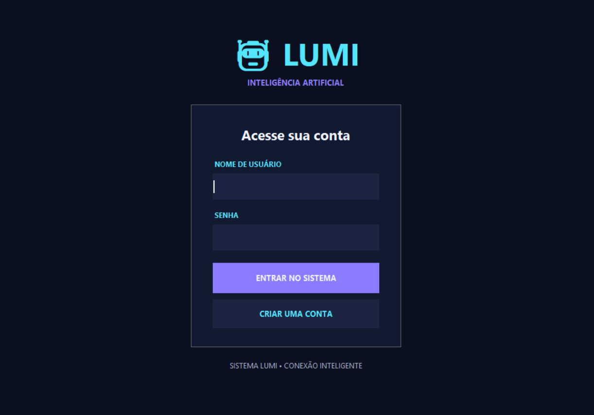
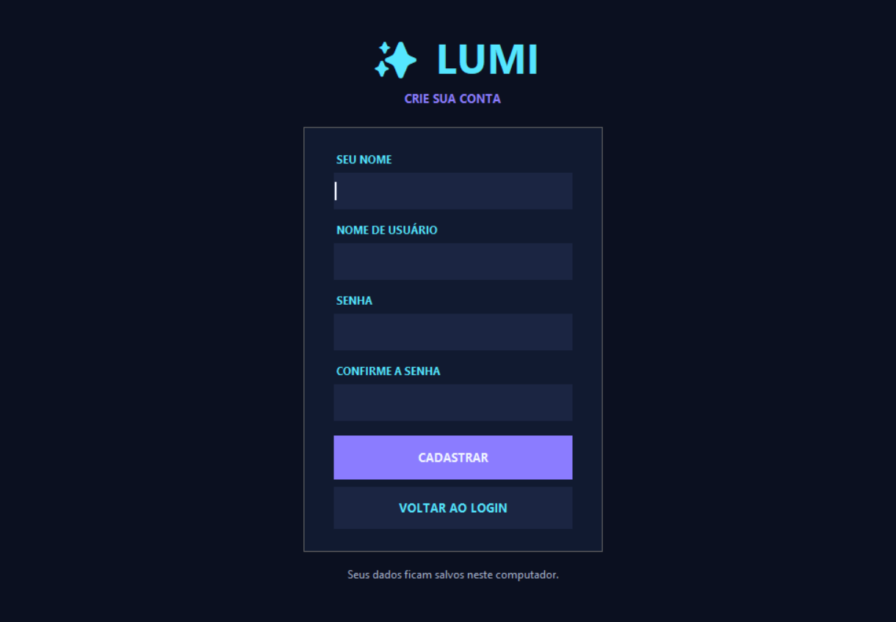
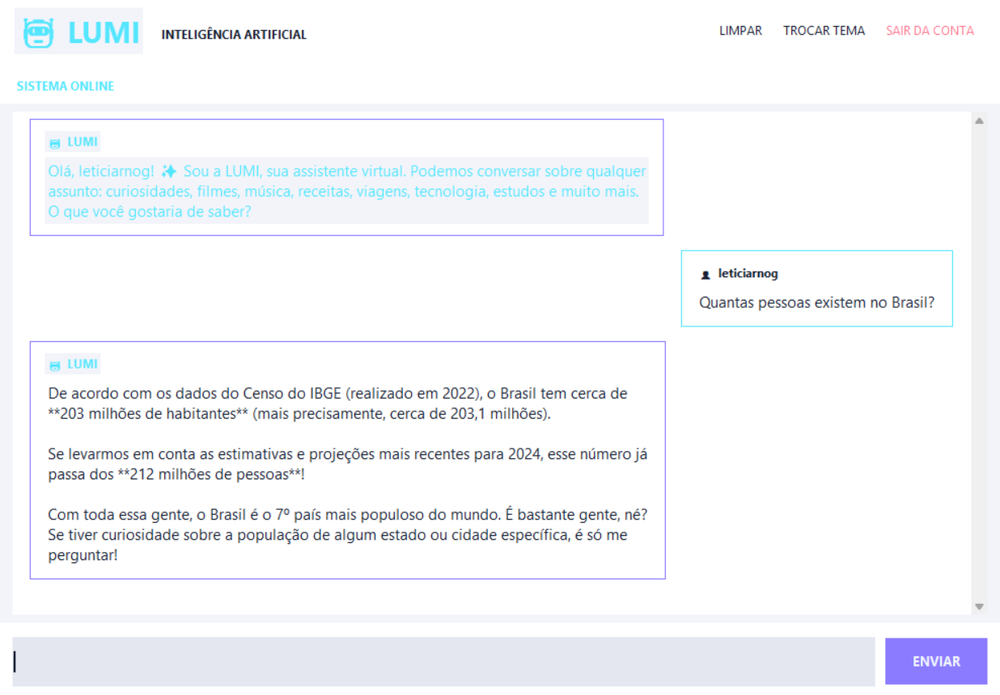
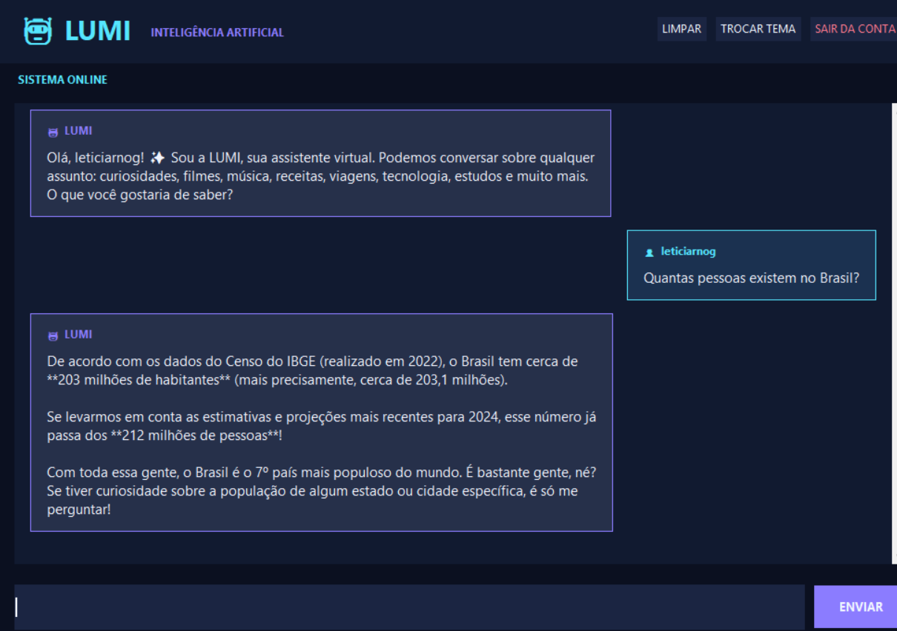

# LUMI — Assistente Virtual com Inteligência Artificial

## Sobre o projeto

A LUMI é um assistente virtual desenvolvido em Python que permite aos usuários conversar com uma inteligência artificial por meio de uma interface gráfica para computador.

O projeto possui sistema de cadastro e login, envio de mensagens, limpeza da conversa e opção de alteração de tema.

## Tecnologias utilizadas

- Python
- Tkinter — criação da interface gráfica
- Google Gemini API — respostas da inteligência artificial
- Google Gen AI SDK — comunicação com a API do Gemini
- python-dotenv — leitura das variáveis de ambiente

## Bibliotecas para instalar

As bibliotecas necessárias estão listadas no arquivo `requirements.txt`.

Para instalá-las, execute no terminal:

```bash
pip install -r requirements.txt
```

## Como executar

1. Instale o Python.
2. Instale as bibliotecas do arquivo `requirements.txt`.
3. Configure sua chave da API do Gemini no arquivo `.env`.
4. Execute o arquivo principal:

```bash
python main.py
```

## Telas do projeto

### Login



### Cadastro



### Chat da LUMI — Tema claro



### Chat da LUMI — Tema escuro


